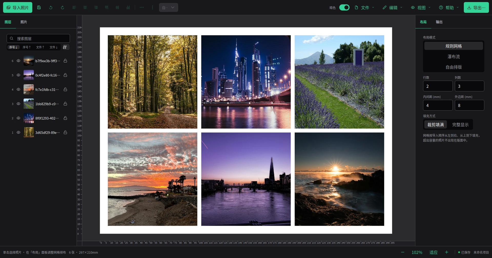
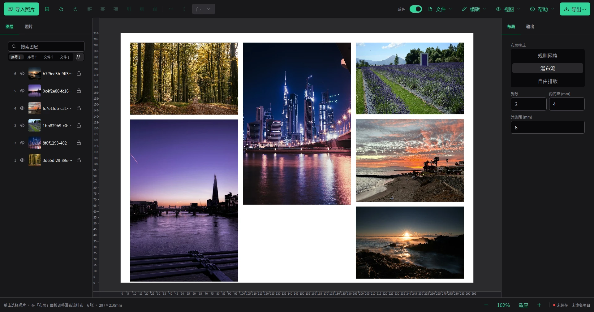
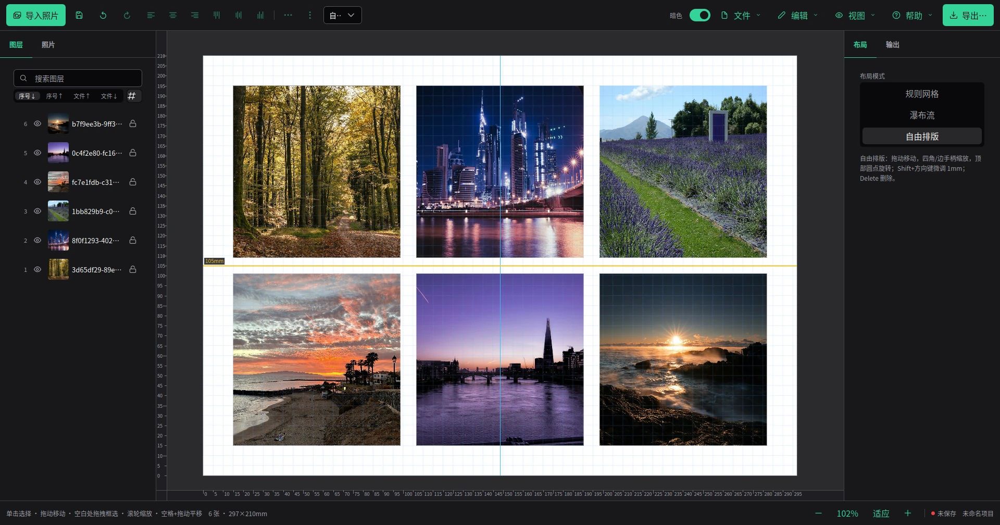
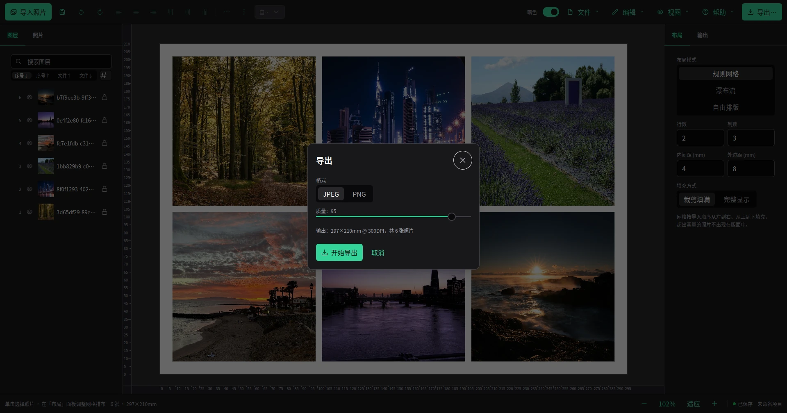

# imgLayout 照片拼接打印工具

imgLayout 是一款跨平台的桌面排版工具：把多张照片按网格、瀑布流或自由摆位的方式拼排在一张画布上，按打印尺寸（毫米 + DPI）精确输出成品大图，适合照片墙排版、拼接打印与装裱出图。

基于 Tauri 2（Rust）+ Vue 3 + PrimeVue 构建，单一代码库产出 Linux 与 Windows 安装包。

## 功能特性

- **三种排版模式**：网格阵列、瀑布流（masonry）、自由拖放，随时切换
- **Photoshop 式图层面板**：图层序号、按序号/文件名排序、搜索过滤、可见性/锁定、不透明度、双击重命名、拖拽调整叠放次序
- **精排版工具**：标尺、参考线、网格与边缘吸附、多图层对齐、组合
- **可配置快捷键**：全部编辑命令支持自定义键位
- **单文件项目包（.imglayout）**：布局数据与照片原图一并打包，跨设备完整恢复，缺图有明确提示
- **打印级导出**：JPEG/PNG，按画布 DPI 渲染成图
- **亮/暗主题**：默认 Photoshop 式暗灰主题，一键切换

## 界面预览



| 瀑布流排版 | 精排版工具：标尺 / 参考线 / 网格吸附 |
| ---- | ---- |
|  |  |



> 预览图中的演示照片来自 [Unsplash](https://unsplash.com/)。

## 安装

从 [GitHub Releases](https://github.com/GitHubNull/imglayout/releases) 下载对应平台的安装包：

| 平台 | 安装包 |
| ---- | ---- |
| Windows | `imgLayout_x.x.x_x64-setup.exe`（NSIS 安装器） |
| Linux | `imgLayout_x.x.x_amd64.deb` 或 `imgLayout_x.x.x_amd64.AppImage` |

安装后打开「imgLayout 照片拼接打印工具」即可使用。软件内的使用教程可从顶栏问号按钮随时查看。

## 自行构建

前置要求：Node.js 20+ 与 pnpm 10、Rust 工具链（stable），Linux 需安装 webkit2gtk 等 Tauri 系统依赖。

```bash
git clone <本仓库地址>
cd imgLayout
pnpm install

pnpm dev      # 开发模式（Tauri 窗口 + Vite 热更新）
pnpm build    # 产物：src/backend/target/release/ 及打包安装包
pnpm check    # 零告警门禁：clippy -D warnings / fmt / vue-tsc / vite build
pnpm test     # cargo test + vitest
```

## 文档

| 读者 | 入口 |
| ---- | ---- |
| 普通用户（使用教程） | [doc/user/](doc/user/) —— 软件内「使用教程」弹窗同款内容 |
| 人类开发者（开发维护） | [doc/developer/](doc/developer/) |
| AI 编程代理（开发维护） | [doc/ai-agent/](doc/ai-agent/) 与 [AGENTS.md](AGENTS.md) |
| 架构与格式细节 | [doc/architecture.md](doc/architecture.md)、[doc/layout-schema.md](doc/layout-schema.md) |
| 更新历史 | [CHANGELOG.md](CHANGELOG.md) |

## 协议与免责声明

本项目以 [MIT 协议](LICENSE) 开源，作者 GitHubNull。

软件按原样提供，无任何担保；使用本软件排版、导出的图片须确保其版权与使用权合法，相关责任由使用者承担。详见 [法律免责声明](LEGAL.md)。
